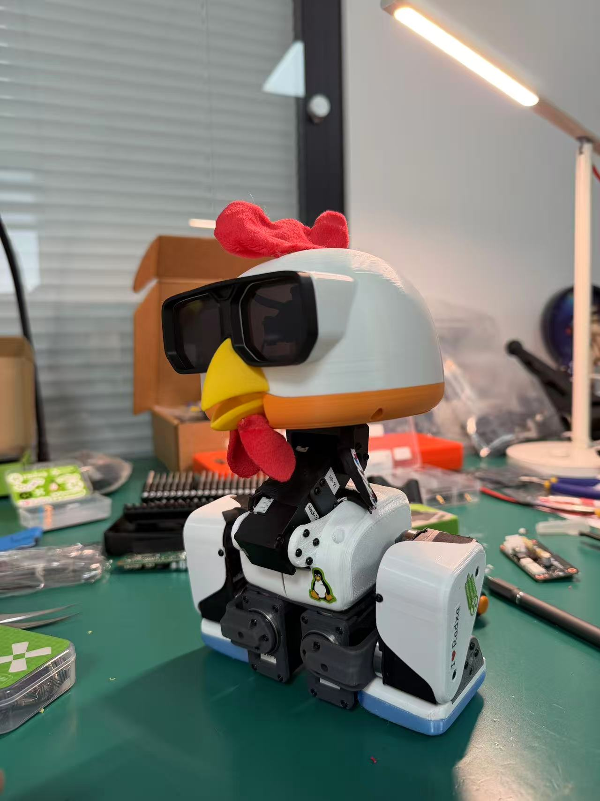
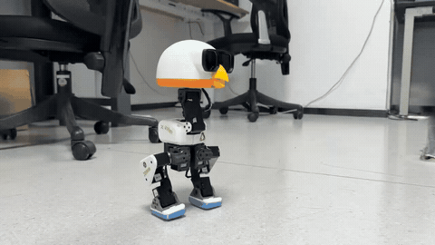

# OpenChicken RL

Based on [Pollen Robotics Microduck RL](https://github.com/pollen-robotics/microduck_rl) at `bae39f5900b318f7e87fc485c30a31213cfa14eb`. This fork retains the native tasks and adds SuperMimic-style motion tracking for OpenChicken. See [UPSTREAM_SOURCE.json](UPSTREAM_SOURCE.json) for provenance.

<table>
  <tr>
    <td align="center" width="50%"></td>
    <td align="center" width="50%"><a href="assets/hardware/openchicken-demo.mp4"></a></td>
  </tr>
  <tr>
    <td align="center">OpenChicken</td>
    <td align="center"><a href="assets/hardware/openchicken-demo.mp4">Watch the original video (8.2 s)</a></td>
  </tr>
</table>

RL training environments for OpenChicken —
a ~800 g, ~25 cm tall bipedal robot — built on
[mjlab](https://github.com/mujocolab/mjlab) (MuJoCo Warp) with PPO for the native tasks. The added Supertracking task uses a learned world model and differentiable policy optimization.
Policies are trained here at 50 Hz, exported to ONNX, and deployed on the real
robot by the runtime in [pollen-robotics/microduck](https://github.com/pollen-robotics/microduck).

The repo encodes the full sim2real recipe: [BAM](https://github.com/Rhoban/bam)
actuator physics, domain randomization, backlash simulation, and the
reward-design lessons that made it work
(see [AGENTS.md](AGENTS.md) for the distilled playbook).

## Quickstart

Requires a CUDA GPU (training runs through MuJoCo Warp) and [uv](https://docs.astral.sh/uv/).

> **On ARM boxes (DGX Spark / GB10, Jetson):** `uv sync` pulls ~2 GB of CUDA
> wheels on first run and uv's default 30 s HTTP timeout can abort mid-download.
> Export `UV_HTTP_TIMEOUT=600` for the first sync.

```bash
git clone https://github.com/crown133/openchicken_rl.git
cd openchicken_rl
source env.sh
uv sync --frozen
source env.sh

# train the walking policy (uses your GPU; ~1-2 h for a usable gait at 4096 envs)
uv run train Mjlab-Velocity-Flat-OpenChicken --env.scene.num-envs 4096

# watch a trained policy in the viewer
uv run play Mjlab-Velocity-Flat-OpenChicken --wandb-run-path <entity/project/run_id>

# export to ONNX for deployment
uv run scripts/export.py Mjlab-Velocity-Flat-OpenChicken --wandb-run-path <...>
uv run publish --onnx output.onnx --repo <user>/openchicken-<name> --kind episodic --duration-s 4.0   # share it (see "Publishing a policy")

# drive the exported policy in CPU MuJoCo with the keyboard
uv run scripts/infer_policy.py --walking output.onnx
```

New runs start from scratch by default. Resume only when explicitly intended:

```bash
uv run train Mjlab-Velocity-Flat-OpenChicken --env.scene.num-envs 4096 \
    --agent.run-name resume --agent.load-checkpoint model_29999.pt --agent.resume True
```

No GPU? Add `--hf-jobs` to any train command to run it on Hugging Face Jobs
instead of locally (see [scripts/hf/README.md](scripts/hf/README.md)).

## Tasks

All task IDs in this fork use `OpenChicken`. For commands referencing an older
run, replace `MicroDuck` with `OpenChicken` in the task ID; old IDs are no longer
registered. Task IDs remain stable. The new robot changes geometry and joint state layout;
old checkpoints require explicit validation before reuse. The internal Python package is `mjlab_openchicken` (renamed with the OpenChicken model migration).

`uv run list-envs` prints the live registry. Flat/Rough variants exist where noted.

<!-- SHOWCASE GRID — one short GIF per task family (sim or real), 3 per row.
     Priority order if you only record a few: Velocity, VelStand (fall+recover),
     Roulade, SitStand, Rollers/Swizzle, BallKick. -->

| Task id | Terrain | Description |
|---|---|---|
| `Mjlab-Velocity-{Flat,Rough}-OpenChicken` | flat/rough | **The main task**: walking with velocity commands + head-pose commands |
| `Mjlab-VelStand-{Flat,Rough}-OpenChicken` | flat/rough | Walking + fall recovery in one policy |
| `Mjlab-StandUp-{Flat,Rough}-OpenChicken` | flat/rough | Stand up from face-down/face-up/sitting, then hold the stand + body-pose control |
| `Mjlab-SitStand-{Flat,Rough}-OpenChicken` | flat/rough | Commanded sit ↔ stand in one policy, gently, head commandable |
| `Mjlab-GroundPick-{Flat,Rough}-OpenChicken` | flat/rough | Crouch and touch the ground with the mouth tip, return to stand |
| `Mjlab-BallKick-Flat-OpenChicken` | flat | Kick a 70 mm / 15 g ball forward (actor is ball-blind) |
| `Mjlab-Roulade-Flat-OpenChicken` | flat | Forward roll over the head, land back on the feet |
| `Mjlab-Velocity-Flat-OpenChicken-Rollers` | flat | Roller-skate velocity tracking (passive wheels under the feet) |
| `Mjlab-Velocity-Swizzle-OpenChicken` | flat | Classic symmetric swizzle skating |
| `Mjlab-RollerCrouch-Flat-OpenChicken` | flat | Crouch while gliding on rollers |
| `Mjlab-RollerSlope-Flat-OpenChicken` | slope | Glide down slopes on rollers |
| `Mjlab-RollerStandUp-Flat-OpenChicken` | flat | Stand up from the ground onto the wheels |
| `Mjlab-Spin-Flat-OpenChicken` | flat | Fast spin in place on rollers |
| `Mjlab-Supertracking-Flat-OpenChicken` | flat | SuperMimic-style V12 motion tracking; use the dedicated trainer below |

At deployment the runtime hot-swaps these native PPO policies (walk / recover / trick)
behind a shared 61-dimensional observation contract, so any of them can take
over the robot at any moment. `scripts/infer_policy.py` rehearses exactly that:

```bash
uv run scripts/infer_policy.py --walking walk.onnx --standing stand.onnx \
    --sitstand sitstand.onnx --roulade roulade.onnx --new-cmd-obs
```

Keyboard-driven (velocity commands, `G` ground pick, `Y` sit/stand, `R` roulade,
`K`/`L` kicks); `--debug`, `--save-csv`, `--record` support sim2real comparisons.
The servos are simulated with the same BAM M6 XL330 model the policies are
trained against (voltage control + load-dependent friction, via
`bam.mujoco.MujocoController`); `--vin` / `--vin-drop-gain` / `--kp-fw` pin the
training DR ranges to one value, `--no-bam` falls back to the XML PD actuators.

### Backlash variants

Every main task has a **Backlash** twin that trains on a model with ±1° of gear
play (2° total) in series with each of the 14 servo joints: insert `-Backlash`
before `OpenChicken` in the task id, e.g. `Mjlab-Velocity-Flat-Backlash-OpenChicken`.

The backlash is modeled properly for sim2real: each servo gets an unactuated
`passive_<joint>_backlash` hinge, and because the real encoder sits on the
output side of the play, both the firmware PD emulation
(`BacklashEncoderBamActuator`) and the `joint_pos`/`joint_vel` observations
read *through* the backlash (`qpos[servo] + qpos[backlash]`). Observation and
action dims are unchanged, so ONNX export and the runtime need no changes.
See `src/mjlab_openchicken/tasks/backlash.py`.

## SuperMimic / Supertracking

Training checkpoints are kept outside version control.

Our motion-tracking task adapts the learned-world-model approach using
[Breezewrf's mjlab reproduction](https://github.com/Breezewrf/supermimic_mjlab/tree/a7cee74636a4c596cd8710f8c2e51f82d78bb150)
as a reference. It is a local OpenChicken adaptation, not the official SuperMimic
implementation. Native PPO tasks keep their existing interfaces.

The world model fits 8-step autoregressive transitions; the actor optimizes a
32-step imagined rollout through the frozen model, with a lambda-return critic.
The OpenChicken adaptation includes BAM M6 actuators, explicit mechanical backlash,
physical randomization context, and a shared real/imagined sensor chain.

### Train from scratch

The checked local setup is Python 3.12.13, mjlab 1.3.0, PyTorch 2.9.1 and an
RTX 4070 Ti 12 GB. `uv.lock` pins the dependencies. `env.sh` activates this
checkout's `.venv` and uses a sibling `.cache/external` directory; override
`OPENCHICKEN_RL_CACHE_ROOT` to select another writable cache location.

Start with a 64-environment smoke test:

```bash
source env.sh
python scripts/train_supertracking.py --robust --smoke \
    --batch-size 128 --wm-batches 4 --replay-device cuda:0 \
    --output logs/supertracking_smoke
```

The following starts a new 1024-environment, 20000-iteration run with Replay
on the GPU. Use a new output directory for each run; do not pass `--resume`
for a fresh run.

```bash
python scripts/train_supertracking.py --robust \
    --num-envs 1024 --iterations 20000 \
    --batch-size 128 --wm-batches 4 --replay-device cuda:0 \
    --output logs/supertracking_v12_1024_20k
```

Defaults: learning rate `2e-4`, 8 collected steps per iteration, Replay capacity
256 steps per environment, 4 world-model batches, batch size 128, 40 warmup
collection steps, 30 world-model-only iterations, evaluation/checkpointing every
100 iterations. The 1024-environment GPU Replay configuration passed a short
training/export test with the original contact allocation, collision model,
solver iterations and tolerances; this is not a completed training result.

### Randomization, backlash and command delay

`--robust` uses the 12-second reference and enables physical parameter
randomization, fixed encoder/IMU offsets, observation noise and delays, and
14 passive backlash hinges. Actual randomized parameters are available to the
world model and critic; the actor receives sensor history and motion features.
Backlash positions and velocities are dynamic model state, while white sensor
noise is applied outside the dynamics model.

BAM resamples a shared lag for the 14 servos in each environment at every 5 ms
physics step: 3–6 steps, or 15–30 ms. Replay records the seven-entry command
queue, its valid length, four substep lags and the targets actually received by
BAM. Imagined rollouts use the same differentiable transport queue, including
the encoder-bias correction. Requested actions update the queue; the physical
prediction uses the four ordered delivered targets. Partial resets do not
advance other environments' queues.

Training excludes root-velocity impulse pushes. Independent push evaluation is
available through `make_openchicken_supertracking_env_cfg(robust=True, push_test=True)`;
its post-push state is refreshed before reading derived velocities.

Optional `--replay-device cpu`, `--constraint-capacity` and `--contact-capacity`
flags adjust memory allocation. They are not used by the 1024-environment
command above. Buffer overflow is checked and stops the run.

### V12 side-lean assets

The accepted motion is a diagonal upward lean, a partial return toward center,
then a diagonal downward lean. Head roll turns inward on the upward beat and
slightly outward on the downward beat. Six repetitions occupy ten seconds.

| Directory | Contents | Use |
|---|---|---|
| [`motion/assets/v12_original`](motion/assets/v12_original) | Accepted style trajectory, front/rear videos and storyboards | Visual reference before collision repair |
| [`motion/assets/v12`](motion/assets/v12) | Collision-aligned 10 s `motion.npz`, style trajectory and preview | Nominal tracking reference |
| [`motion/assets/v12_stand_transitions`](motion/assets/v12_stand_transitions) | 1 s entry + unchanged 10 s V12 + 1 s exit, aligned `motion.npz` and preview | Default `--robust` training reference |

See [motion/README.md](motion/README.md) for formats, previews and checksums.
Assets are versioned in Git. Moving them into this directory does not regenerate
or change the accepted motion. The original kinematic preview is not a learned
policy or a claim of physical stability.

### Outputs and deployment interface

Each run writes configuration/provenance, `metrics.jsonl`, `best.pt`, `last.pt`,
`policy.onnx` and `motion_latents_50hz.npz`. Best checkpoints are ranked by full
motion survival and return; the automatically exported ONNX uses the final actor.
The ONNX contains observation normalization.

The tracking actor interface is `history[10,48] + motion_latent[32] -> action[14]`,
with HOME-relative joint targets in radians. It needs its own runtime integration
and is not interchangeable with native 61D policies or the native publishing
validator below. Training does not launch or control a real robot.

To embed the motion reference from a verified checkpoint export bundle:

```bash
source env.sh
python scripts/embed_supertracking_motion.py \
    --export-dir artifacts/supertracking_best_27900 \
    --output-dir artifacts/supertracking_best_27900_embedded
```

The source bundle contains the ONNX, `motion_latents_50hz.npz`,
`policy_interface.json` and `export_validation.json` recording their hashes and
checkpoint consistency. The converter verifies those hashes, preserves the
decoder/normalizer, and embeds the matching latent table as an ONNX initializer.
It checks every reference frame and loop/reset boundaries against the original
ONNX. No retraining or checkpoint/Replay restoration is involved.

The resulting file takes `history: float32[batch,10,48]` and
`time_step: int64[batch,1]`, and returns `action: float32[batch,14]`.
It needs no external reference file. `time_step` is a **frame index, not seconds**:
start at zero and increment after each inference at 50 Hz. The graph uses
`max(time_step, 0) % reference_frames` (600 frames / 12 seconds for robust V12).
It has no internal clock; repeating a frame index does not advance playback.
Stopping after one cycle or restarting is the caller's responsibility.

History remains external, ordered oldest to newest with the current observation
last. Initialize all ten rows from the first valid 48D observation, with the
previous-action block zero (HOME-relative), and refill history on a fresh start.
After each action, the next observation includes that previous action. Supply
un-normalized observations; the ONNX includes normalization. Resetting a buffer
does not put the robot into the trained entry posture. Joint ordering, HOME,
control frequency and reset details are recorded in the new `policy_interface.json`.
Native 61D policies and the original latent-input exports retain their interfaces.

Explicit BAM transport uses checkpoint schema `bam_substeps_v1`; earlier world
models and Replay buffers cannot be resumed under this schema. New training runs
start with fresh models, optimizers, normalizers and Replay.

Development notes are kept locally in `docs/`, which is intentionally ignored by
Git. Runtime logs, checkpoints, caches and virtual environments are also ignored;
reference trajectories and previews under `motion/assets/` are explicitly included.

## Actuator model

All tasks use the [BAM](https://github.com/Rhoban/bam) M6 actuator model for
the Dynamixel XL330 (voltage control law, back-EMF, Coulomb/Stribeck/load-dependent
friction), with per-env domain randomization on battery voltage, voltage sag
under load, command delay, and friction magnitude
(`FrictionDRBamActuator` in `src/mjlab_openchicken/actuator/`).

At this scale — tiny servos driving a ~800 g biped — actuator fidelity is most
of the sim2real gap, which is why the actuator is modeled down to its voltage
control law instead of an ideal PD.

## Robot models

MJCF models live in `src/mjlab_openchicken/robot/openchicken/`. The imported
OpenChicken geometry replaces the old robot. All variants have 14 policy servos
plus an independent `passive_beak` position servo, held closed at zero. Native
policies retain 61 observation inputs and 14 action outputs; Supertracking keeps
its 48D history and 32D latent interface.

| XML | Used by |
|---|---|
| `robot_walk.xml` | Velocity, with the imported walking collision set |
| `robot_groundcontact.xml` | StandUp, SitStand, GroundPick, BallKick, Roulade, Supertracking |
| `robot_groundcontact_rollers.xml` | Roller tasks, with four passive wheels |
| `robot_allcollisions.xml` | VelStand protective fall, including servo housing contacts |
| `robot_allcollisions_rollers.xml` | Full-contact roller model, retained for inspection |
| `robot_*_backlash.xml` | Matching variants with 14 backlash hinges |

The imported files named `allcollisions` contained a curated collision set.
That set is retained as `groundcontact`; full-contact models add collision copies
of the remaining visual meshes while preserving joint, inertia and actuator data.

`scenes/` contains floor/keyframe scenes, ball and room props. `assets/` contains
runtime meshes. `source/cad/` and `source/urdf/` preserve design/export inputs.
`export/` holds historical Onshape recipes and the backlash helper. These recipes
predate the manually integrated OpenChicken head: do not regenerate the runtime
models directly from them. The imported archive and export log are kept under
`artifacts/model_import/`.

Existing `motion/assets/` references and checkpoints remain unchanged. Body and
joint name compatibility does not establish dynamic compatibility with the new
head; validate stance and motion before starting a long training run. The migration
audit found the previous HOME pose unstable in a 3-second open-loop hold with
the new geometry; it is retained as an initial training pose, not a validated
standing controller. See `artifacts/model_import/validation.json` for results.

<!-- IMAGE — side-by-side render: walk model vs rollers model (or a collision-geom
     visualization). One image here makes the model-variant story instant. -->

## Project structure

```
src/mjlab_openchicken/
├── robot/
│   ├── openchicken/                  # robot XMLs + assets/scenes/export/source
│   └── openchicken_constants.py        # robot cfgs, HOME frame, BAM actuator cfg
├── actuator/friction_dr_bam.py       # BAM + friction DR + backlash encoder feedback
├── tasks/
│   ├── __init__.py                   # task registration (base + backlash variants)
│   ├── mdp.py                        # rewards, events, observations, custom classes
│   ├── backlash.py                   # make_backlash_variant() env-cfg wrapper
│   └── openchicken_*_env_cfg.py        # one cfg module per task family
├── supertracking/                   # world model, actor/critic, replay and BAM delay queue
├── train_cli.py                      # `train` script (identical to mjlab's)
├── train_hook.py                     # intercepts `train ... --hf-jobs`
└── hf_jobs.py                        # Hugging Face Jobs submission
```

Conventions worth knowing:

- The observation layout is shared across native PPO policies (61-dim actor obs:
  48 proprioception + commands `[twist(3), head_pose(4), body_pose(6)]`), which
  is what makes runtime policy hot-swapping possible. Envs that don't use a
  command slot zero-pad it rather than dropping it.
- Unactuated joints are all named `passive_*` (roller wheels, backlash
  hinges); actuators, joint observations and pose rewards select servo joints
  with `^(?!passive_).*`.
- Domain-randomization toggles are `ENABLE_*` booleans at the top of each
  env cfg file.
- Joint layout (14 servos): 0–4 left leg (hip_yaw, hip_roll, hip_pitch, knee,
  ankle), 5–8 neck/head (neck_pitch, head_pitch, head_yaw, head_roll),
  9–13 right leg.
- The exporter bakes the observation normalizer into the ONNX graph — always
  deploy ONNX produced by `scripts/export.py`, never a hand-converted
  checkpoint, or the policy sees unnormalized observations at runtime.

[AGENTS.md](AGENTS.md) documents the env-building workflow and the reward-design
rules learned across the project (also aimed at AI coding agents working in
this repo).

## Publishing a policy

This section applies to native 61D policies; Supertracking uses its dedicated
export and runtime contract described above.

`uv run publish` puts a policy on the Hugging Face Hub in the shape the robot's
daemon loads: one `policy.onnx` with the observation normalizer baked in, a
`manifest.json` following schema 2 of the
[openchicken policy manifest](https://github.com/pollen-robotics/microduck/blob/main/docs/policy-manifest.md),
and a README saying how to run it. Anyone with a openchicken can then install it
with one command, no daemon release needed.

```bash
# From a wandb run — exports through the one safe path, then uploads
uv run publish --task Mjlab-StandUp-Flat-OpenChicken \
    --wandb-run-path <entity/project/run_id> --checkpoint 3000 \
    --repo <user>/openchicken-standup --kind episodic --duration-s 6.0 \
    --description "Stands up from the ground and holds the standing pose."

# From an ONNX you already exported (validated, not re-exported)
uv run publish --onnx output.onnx --repo <user>/openchicken-flamingo \
    --kind perpetual --unwind-s 1.5 --twist-help "[flag, side, 0]"

# A new gait for a slot
uv run publish --onnx output.onnx --repo <user>/openchicken-my-walk --kind perpetual --slot walk

# Ship a rollout video too: uploaded as replay.mp4, which the Hub's replay widget plays
uv run scripts/render_policy.py output.onnx --seconds 10 --video media/bow.mp4
uv run publish --onnx output.onnx --repo <user>/openchicken-bow --kind episodic --duration-s 4.0 \
    --video media/bow.mp4

# A remix (warm-started / fine-tuned from someone's published policy): name the parent so the
# model card sets `base_model` and the Hub links the two
uv run publish --onnx output.onnx --repo <user>/openchicken-deep-bow --kind episodic --duration-s 5.0 \
    --base-model <owner>/openchicken-polite-bow

# See what would be uploaded without touching the Hub
uv run publish --onnx output.onnx --repo <user>/openchicken-bow --kind episodic --duration-s 4.0 --dry-run
```

Then on a robot:

```bash
sudo robotctl policy add polite-bow <user>/openchicken-polite-bow   # episodic: length comes from the manifest
sudo robotctl policy add flamingo <user>/openchicken-flamingo --hold 5   # held pose: you pick how long
sudo robotctl policy load walk <user>/openchicken-my-walk                # gait: into the walk slot
robotctl robot do polite-bow
```

What `--kind` means, and what each needs:

- **episodic** — runs for `--duration-s` and returns itself to a standing pose
  (kicks, roulade, a bow). Add `--chain` if holding the button should repeat it.
- **perpetual** — runs until told otherwise. Two shapes:
  - a **gait** (a new walk or stand): add `--slot walk` (or `stand`) and
    nothing else; the owner installs it with `robotctl policy load walk <repo>`.
  - a **held pose** (the flamingo): give `--unwind-s`, how long the daemon
    drives the idle twist (`--idle`, zeros by default) before handing back to
    the gait, so the robot is not let go of on one foot. The owner runs it as a
    one-shot with `policy add ... --hold <seconds>`.

Before anything is uploaded, `publish` checks the graph is `[1,61] -> [1,14]`
(a 51-D legacy policy is refused with a message), runs it on plausible inputs
and refuses NaNs or a constant output, fills the `training` block from git and
wandb (task, commit, branch, dirty flag, run, checkpoint), and refuses to
overwrite an existing `.onnx` in the repo without `--force`. Repos are created
private; `--no-private` for public, `--tag v1` to tag the revision.

Only constant-command policies are publishable this way. Phase-driven moves
(the ground pick) and the posture-flag sit↔stand are driven by the daemon
itself and live in the official set, `pollen-robotics/microduck-policies`.

## Tests

```bash
uv run --with pytest pytest tests/
```

Config-invariant and reward-function tests lock in joint-index mappings, reward
sign conventions, and NaN guards. Supertracking adds reference checksum, command
transport and gradient tests. CUDA-only tests exercise actual BAM timing, partial
reset isolation and Replay transfers, and are skipped when CUDA is unavailable.

## Related projects

- [openchicken](https://github.com/pollen-robotics/microduck) — the OpenChicken project home, including the onboard runtime that runs the exported policies
- [mjlab](https://github.com/mujocolab/mjlab) — the training framework (MuJoCo Warp + rsl_rl)
- [BAM](https://github.com/Rhoban/bam) — better actuator models, by Rhoban

## License

The original MIT text from this repository's initialization is retained in
[LICENSE-PROJECT-MIT](LICENSE-PROJECT-MIT); it does not replace the upstream
code and model licenses below.

The code in this repository is licensed under the Apache License 2.0. See the [LICENSE](LICENSE) file for details.

The 3D model files (the `.stl` meshes in `src/mjlab_openchicken/robot/openchicken/assets/`
and `src/mjlab_openchicken/robot/xl330_test_bench/assets/`) are licensed under
[Creative Commons Attribution-NonCommercial-ShareAlike 4.0 International (CC BY-NC-SA 4.0)](https://creativecommons.org/licenses/by-nc-sa/4.0/).
See [LICENSE-MODELS.md](LICENSE-MODELS.md) for the exact scope and attribution.
