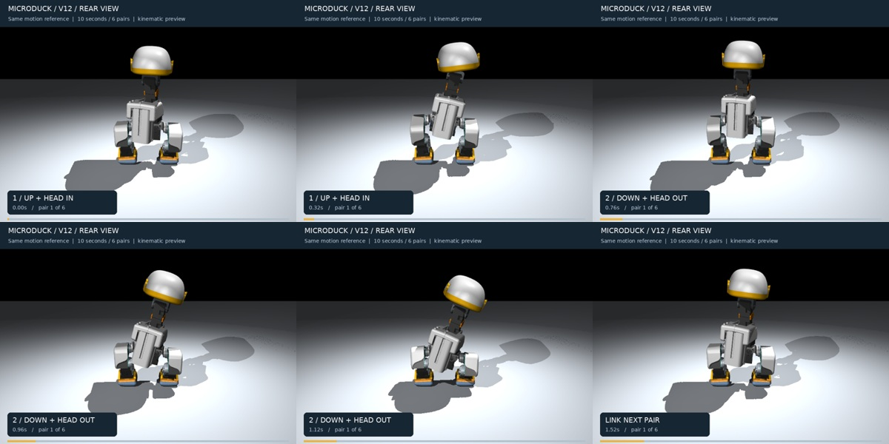

# V12 side-lean reference assets

These are the accepted robot motion assets, not motion extracted from a human
video and not trained policy rollouts. No motion was regenerated for this upload.

| Asset set | Duration | Purpose |
| --- | --- | --- |
| [v12_original](assets/v12_original/) | 10 s | Accepted style: diagonal up, recenter, diagonal down; inward head roll on the up beat and slight outward roll on the down beat |
| [v12](assets/v12/) | 10 s | Collision-aligned reference, with the left fixed foot advanced 25 mm and its leg joints re-solved; torso/head style preserved |
| [v12_stand_transitions](assets/v12_stand_transitions/) | 12 s | 1 s transition from standing, unchanged collision-aligned V12, 1 s return to standing |

## Previews

- Original V12: [front](assets/v12_original/preview.mp4), [rear](assets/v12_original/rear_preview.mp4).
- Collision-aligned V12: [preview](assets/v12/collision_fixed_preview.mp4).
- Standing transitions: [front/rear preview](assets/v12_stand_transitions/stand_v12_stand_front_rear.mp4).



## Data

`style_reference_50hz.npz` stores the offline kinematic style trajectory.
`v12/motion.npz` and `v12_stand_transitions/motion.npz` are aligned to the training
model's joint/body ordering, with positions, velocities and `wxyz` quaternions.
They contain 501 and 601 frames respectively, including the repeated endpoint.
The original set also retains its 150 Hz cycle diagnostics; the repaired set
retains `cycle_150hz.npz` for the collision-aligned cycle.

Each directory's `manifest.json` records file sizes, SHA-256 and original
workspace locations. Training references retain these exact hashes:

```text
v12/motion.npz
d435f6b2720e09a28c4579d43522889d86d9c94bc2f33887608db4078dcc67b4

v12_stand_transitions/motion.npz
fd439533055c22c9b8b032b883a60bdc0521efd8466ffefc46a702db0cda9374
```

The original style predates collision repair and is retained for visual
comparison. Training uses the aligned references; `--robust` selects the version
with standing transitions. The previews demonstrate kinematics, not dynamic
tracking success or hardware readiness.
